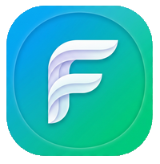

# La Mia Salute 🏥

**La Mia Salute** è un'applicazione Android (e Web) progettata per semplificare la gestione quotidiana della propria salute e di quella dei propri familiari. Grazie a un'interfaccia intuitiva e moderna, permette di tenere traccia di farmaci, parametri vitali e documenti medici in un unico posto sicuro e locale.

  

## 🌟 Funzionalità Principali

### 💊 Gestione Terapie e Farmaci
- **Diario Assunzioni**: Registra le assunzioni quotidiane di farmaci con stati "Assunto", "Saltato" o "Pianificato".
- **Promemoria**: Ricevi notifiche push per non dimenticare mai una dose.
- **Gestione Scorte**: Monitora le quantità rimanenti nel tuo catalogo farmaci con avvisi automatici quando le scorte sono in esaurimento.
- **Bugiardini Online**: Accesso rapido alle schede tecniche dei farmaci.

### 📈 Monitoraggio Parametri Clinici
- **Pressione Arteriosa**: Registra pressione sistolica, diastolica e battiti con analisi cromatica basata sui livelli di rischio.
- **Glicemia**: Tieni traccia dei livelli di glucosio con tag e note contestuali.
- **Andamento Peso**: Monitora le variazioni di peso nel tempo.
- **Grafici Interattivi**: Visualizza l'andamento storico di tutti i parametri per identificare trend e anomalie.

### 📝 Note e Documenti
- **Note Personali**: Spazio dedicato per annotare sintomi, sensazioni o domande per il medico.
- **Archivio Referti**: Organizza i tuoi esami e referti medici in modo ordinato.
- **Database Esami**: Storico dettagliato dei valori clinici passati.

### 👥 Profili Multipli
- Gestisci più profili (es. familiari) all'interno della stessa app, ognuno con i propri dati e impostazioni indipendenti.

### 📊 Export e Backup
- **Report PDF**: Genera report professionali pronti da condividere con il tuo medico.
- **Export CSV**: Esporta i dati in formato Excel per analisi approfondite.
- **Backup Locale**: Salva e ripristina i tuoi dati tramite file JSON per la massima privacy e sicurezza.

---

## 🛠️ Tecnologie Utilizzate

L'app è sviluppata con un approccio moderno e performante:
- **Frontend**: [React](https://reactjs.org/) con [TypeScript](https://www.typescriptlang.org/)
- **Build Tool**: [Vite](https://vitejs.dev/)
- **Styling**: [Tailwind CSS](https://tailwindcss.com/)
- **Icone**: [Lucide React](https://lucide.dev/)
- **Mobile Framework**: [Capacitor](https://capacitorjs.com/)
- **Database**: SQLite (tramite Capacitor Community SQLite)
- **PDF Generation**: jsPDF

---

## 📄 Licenza e Disclaimer
L'applicazione è sviluppata per uso personale. I dati sono salvati esclusivamente in locale sul dispositivo. Si ricorda che l'app è uno strumento di supporto e non sostituisce in alcun modo il parere di un medico professionista.

---

  Sviluppato con ❤️ per uso personale.

